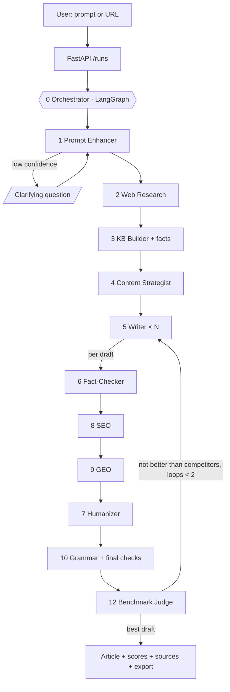

# Plan: Content Writing Multi-Agent System

**Status:** The backend vertical slice and Phase A (groundwork) are built on branch `feat/backend-vertical-slice`. Agents 1, 2, 3, 5, 7 and 10 run today, and 7 already keeps the AI-likeness score below 10. Next: Phase B (Content Strategist). See [`apps/api/README.md`](apps/api/README.md) and the TDD evidence in [`docs/tdd/backend-vertical-slice.tdd.md`](docs/tdd/backend-vertical-slice.tdd.md).
**Updated:** 2026-10-23
**Scope:** Text only. The system writes blog articles; it does not generate images, and image, PDF and audio input are out of scope for now.

---

## 1. Requirements

The user gives a topic as a prompt or a URL. The system:

1. **Improves the prompt.** It works out the intent, audience, tone, voice, format and target keyword, and asks one clarifying question when the prompt is ambiguous.
2. **Researches the live web**, including the blogs that currently rank for the keyword.
3. **Builds a knowledge base** from the scraped pages, plus a list of numeric facts with their sources.
4. **Plans an outline** that covers more than the competitors do.
5. **Writes several drafts** grounded in the knowledge base, with citations.
6. **Fact-checks** every claim.
7. **Optimizes for SEO**, the classic search-engine ranking.
8. **Optimizes for GEO** (Generative Engine Optimization), so AI answer engines such as ChatGPT, Perplexity, Google AI Overviews and Gemini are likely to quote and cite the article.
9. **Makes the writing human.** The final article must read as if a person wrote it, with an **AI-likeness score below 10**, and must not copy competitor text.
10. **Checks grammar** and readability.
11. **Compares** the drafts with the competitor blogs, and returns only the best one.

Non-functional requirements: fast hosted models with automatic fallback, free fallbacks for every optional paid service, traceable sources, cost and rate limits, and a user-friendly UI with live progress.

> **Caveat:** No system can *guarantee* a top ranking or an AI citation. Both also depend on backlinks, domain authority and time. The system maximizes the on-page factors it controls and measures them against the current top-ranking pages. The AI-likeness score is a local measure; external detectors such as GPTZero or Originality.ai may disagree with it.

---

## 2. Agents: 12 (1 Orchestrator + 11 Specialists)

| # | Agent | Responsibility | How it keeps the writing human | State |
|---|---|---|---|---|
| 0 | **Orchestrator** | LangGraph state machine: clarifying-question pause, N parallel drafts, revision loop, budget limit with graceful downgrades, final quality checks | Final checks require AI-likeness below 10 | Partly done |
| 1 | **Prompt Enhancer** | Turns the prompt or URL into a brief: intent, audience, tone, keywords, format, target questions, optional brand-voice sample and site URL | Chooses the voice (we/you/I), how formal to be, and whether contractions are allowed | Done (text); URL input to do |
| 2 | **Web Research** | Searches, scrapes and cleans pages (robots.txt honoured, SSRF-guarded). Tags pages as *source* or *competitor*. Keeps headings and captures each competitor's title, meta description and JSON-LD types | Supplies concrete material instead of generalities | Done |
| 3 | **Knowledge Base Builder** | Chunks and embeds pages (Gemini or Voyage embeddings, hashing fallback). Extracts numeric facts verbatim with their source | Specific facts make writing sound informed | Done |
| 4 | **Content Strategist** | Profiles competitors (outline, word count, entities, questions) and finds the gaps. Produces an outline that covers more than they do | Varies section length and format so the structure doesn't look like a template | Phase B |
| 5 | **Writer** | Writes N drafts (default 3), each from a different angle, following the outline. Facts only from the knowledge base, cited `[n]` | Shared style rules, the brief's voice, numbers woven into sentences | Partly done (1 draft) |
| 6 | **Fact-Checker** | Splits a draft into claims, checks each against the knowledge base, and removes or softens unsupported ones. Produces a factual-support score | Rewrites only the claim, keeping the paragraph's voice | Phase C |
| 8 | **SEO Optimizer** | Deterministic rule score (0–100) and one LLM call that fixes only the failing rules. Writes the title tag, meta description, slug and JSON-LD | Keyword density capped at 2.5%; stuffing lowers the score | Phase D |
| 9 | **GEO Optimizer** | Answer-first summary, a quotable definition, cited statistics from the facts list only, attributed quotes, an FAQ, clear entities and a freshness line. GEO score = rule checklist + simulated answer engine | Conversational summary and FAQ answers; tables only for real comparisons | Phase E |
| 7 | **Humanizer** | Runs **after** SEO and GEO. Keeps AI-likeness below 10, replaces em dashes in code, guards originality against all scraped pages, applies brand voice | Rewrites only flagged paragraphs; never changes citations, numbers, keywords or headings | Partly done |
| 10 | **Grammar & Readability** | LanguageTool fixes, then recomputes AI-likeness, SEO, GEO checklist and readability on the final text | Minimal corrections | Done |
| 12 | **Benchmark Judge** | Ranks drafts on a combined score, then compares the top drafts head-to-head with the top competitors, in both orders. Sends the gap list back to the Writer (at most 2 loops) | Human-likeness is 15% of the score and a head-to-head criterion | Phase G |

Agent 11 (Visual / Media) from the earlier plan has been removed: the system produces text only.

**Models:** Gemini (`gemini-3.6-flash`, `gemini-3.5-flash-lite` for the light tier) is the primary model for speed; `gemini-3.8-flash` was measured at ~117 s per call on this account versus ~2 s, so it is not the default. Groq (`openai/gpt-oss-120b` / `gpt-oss-20b`) takes over any call Gemini fails or rate-limits. Local Ollama and the Anthropic API remain alternative backends.

---

## 3. Architecture

### Key design decisions

- **The Humanizer runs last among the LLM editors.** SEO and GEO edits are what bring back machine-typical phrasing, so the style pass comes after them. Shared edit guards ([`tools/guards.py`](apps/api/src/cwas/tools/guards.py)) protect their work: a rewrite may not change citations, add numbers that aren't in the original or in the facts list, or drop the primary keyword.
- **Statistics come only from the facts list.** The KB Builder extracts source sentences that carry numbers, verbatim. Any number an agent adds must appear there.
- **Hybrid scoring, not LLM opinion alone.** Judge weights: SEO 20%, GEO 20%, coverage 15%, factual support 15%, human-likeness 15%, readability 10%, originality 5%. The head-to-head judge runs in both orders and counts only when they agree, and uses a different provider from the writer where possible.
- **Free-tier friendly.** Client-side rate limits, Groq overflow, batched fact checks and judging, deterministic pre-ranking, and an N=1 economy mode.
- **Budget limit with graceful downgrades.** Token usage is tracked per run and per agent. When the limit gets close, the run cuts N to 1, then skips the GEO simulation, then skips the revision loop.

---

## 4. SEO and GEO rules

### SEO (deterministic score 0–100)

| Rule | Check |
|---|---|
| Title tag | 50–60 characters, keyword near the start |
| Meta description | 140–160 characters, includes the keyword and a concrete benefit |
| Headings | One H1, no skipped levels, keyword in at least one H2, real questions as headings |
| Keywords | In the first 100 words; density 0.5–2.5%; secondary keywords present |
| Depth | At least 0.9× competitors' median word count; all outline sections present |
| Slug | Lowercase, hyphenated, at most 6 words, contains the keyword |
| Links | Outbound links to cited sources; internal-link suggestions when a site URL is given |
| JSON-LD | `BlogPosting` (headline, description, author, dates, `about`/`mentions` entities), plus `FAQPage`/`HowTo` when the article has that structure |
| Readability | Grade level within the audience's target band |

Google now limits FAQ rich results to authoritative government and health sites and has retired HowTo rich results, so the score card doesn't promise rich snippets. The JSON-LD is still generated because it helps search and AI engines understand the page.

### GEO

Based on the GEO study by Aggarwal et al. (2023): cited statistics, quotations and source citations raised how often AI engines used a page; keyword stuffing did not.

| Technique | Check |
|---|---|
| Answer first | The first 40–60 words answer the primary question directly |
| Quotable definition | A one-sentence "X is …" definition early |
| Statistics | At least one cited statistic every ~300 words, from the facts list only |
| Quotations | Attributed, from the scraped sources, cited |
| FAQ | The target questions, each with a self-contained 40–60 word answer |
| Entity clarity | Full names on first mention; entities listed in the JSON-LD |
| Structure | Tables and numbered steps only where they fit |
| Freshness | A visible "Updated" date plus `dateModified` |

The GEO score is half the checklist and half a simulated answer engine: it answers the target questions from a shuffled mix of our article and competitor pages, and we measure how often it cites ours.

### Export

- **HTML:** `<title>`, meta description, canonical, Open Graph title and description, JSON-LD, semantic `<article>`/`<section>` markup.
- **Markdown:** YAML front matter with the same metadata.
- **DOCX:** for editors.

---

## 5. Tech stack

| Layer | Choice |
|---|---|
| Backend | Python 3.13 + uv, FastAPI, Pydantic v2, SSE |
| Orchestration | LangGraph 1.x (checkpointing, `interrupt()`, parallel `Send`) |
| LLMs | Gemini (primary), Groq (fallback), with client-side rate limits; Ollama or Anthropic as alternatives |
| Search | DuckDuckGo (free) or Tavily; DataForSEO optional for keyword volume and People-Also-Ask data |
| Scraping | httpx + trafilatura (Markdown with headings), robots.txt, SSRF guard |
| Embeddings | Gemini `gemini-embedding-2` or Voyage; offline hashing fallback |
| Grammar | LanguageTool (self-hosted) + textstat |
| Storage | In-memory today; Postgres 17 + pgvector + LangGraph Postgres checkpointer in Phase I |
| Frontend | Next.js 16 + React 19 + TypeScript + Tailwind v4 + shadcn/ui; TipTap editor |
| Evals / tests | pytest (TDD, 80% coverage gate), golden topic set in CI; Vitest + Playwright for the web app |
| Deploy | Docker Compose |

---

## 6. Phases

Each agent is built test-first (a failing-test commit, then a passing one), and the evidence is recorded in `docs/tdd/`.

| Phase | Scope | State | Done when |
|---|---|---|---|
| Slice | Agents 1, 2, 3, 5, 10; API + SSE; Gemini → Groq fallback; Humanizer with AI-likeness below 10 | **Done** | Live runs complete; AI-likeness 5.8 on a live run |
| A | Groundwork: keep headings when scraping, competitor SEO metadata, fact extraction, Gemini embeddings, token usage per run and agent, client-side rate limits, shared edit guards | **Done** | Unit tests pass; outlines, metadata and facts confirmed on real pages (the full live run found no competitors because DuckDuckGo returned nothing, which now raises a warning) |
| B | **4 Strategist** + Writer follows the outline and voice | Next | Coverage of competitor subtopics ≥ 90%; raw-draft AI-likeness goes down |
| C | **6 Fact-Checker** | Planned | Factual support ≥ 95%; a planted false claim is removed |
| D | **8 SEO** + export with metadata | Planned | Rule tests; SEO ≥ 80; JSON-LD validates |
| E | **9 GEO** + Humanizer moved last | Planned | GEO simulation improves after optimization; AI-likeness still below 10 |
| F | **7 Originality guard, brand voice, new AI-likeness signals** (paragraph-length uniformity, repeated openers, filler words) | Planned | Planted copied paragraph is rewritten; signals tested on fixed samples |
| G | **0 Parallel drafts + budget** and **12 Judge + loop** | Planned | Loop always ends; same input picks the same winner ≥ 90% of the time |
| H | **Frontend**: prompt/URL box with voice options, live timeline, score card, comparison tab, editor, export | Planned | Playwright: prompt → timeline → article → export |
| I | **Hardening**: Postgres + pgvector, 20-topic evaluation set in CI, auth, deploy | Planned | `docker compose up` runs everything; CI fails if quality drops |

---

## 7. API

| Method | Path | Purpose |
|---|---|---|
| POST | `/runs` | Start a run → `run_id` |
| GET | `/runs/{id}/stream` | SSE: `agent_started`, `agent_finished` (with duration and tokens), `question`, `done`, `error` |
| POST | `/runs/{id}/answer` | Answer the clarifying question |
| GET | `/runs/{id}` | Article, brief, scores, usage, warnings |
| GET | `/runs/{id}/export?format=md\|html\|docx` | Download the article (Phase D) |
| GET | `/runs` | History (Phase I) |

---

## 8. Risks

| Risk | Severity | Mitigation |
|---|---|---|
| Free-tier quotas: N=3 is roughly 35–45 LLM calls per run | HIGH | Rate limits + Groq overflow; batching; deterministic pre-ranking; N=1 economy mode |
| SEO/GEO formatting pushes the article back toward a template | HIGH | Humanizer runs last; keyword-density and list caps; varied outline sections; final AI-likeness check |
| Unsupported numbers or hallucinated facts | HIGH | Numbers only from the facts list (enforced in code); Fact-Checker; citations fixed |
| Copying competitors | MEDIUM | Originality guard against all scraped pages |
| The local AI-likeness score differs from external detectors | MEDIUM | More signals; optional external detector; reported honestly as a local measure |
| The GEO simulation only approximates real answer engines | MEDIUM | Used as a before/after comparison; checklist is half the score |
| LLM-judge bias | MEDIUM | Both-order comparisons; deterministic metrics carry most of the score; a different provider judges |
| DuckDuckGo timeouts thin out sources | MEDIUM | Retry with backoff; warn below a minimum source count; Tavily optional |
| Prompt injection from scraped pages | MEDIUM | Scraped text is always wrapped as untrusted data |

---

## 9. Acceptance criteria

- [ ] A prompt or URL produces one final, cited article
- [ ] AI-likeness below 10 on the golden topic set
- [ ] Factual support ≥ 95% and originality below the similarity threshold on the golden set
- [ ] SEO ≥ 80 and a GEO score that improves after optimization
- [ ] All 12 agents visible in the live timeline with status, duration and tokens
- [ ] A comparison table against the top-ranking competitors, with the reason this draft was chosen
- [ ] Export to Markdown, HTML (with SEO metadata and JSON-LD) and DOCX
- [ ] `docker compose up` runs the whole system locally
