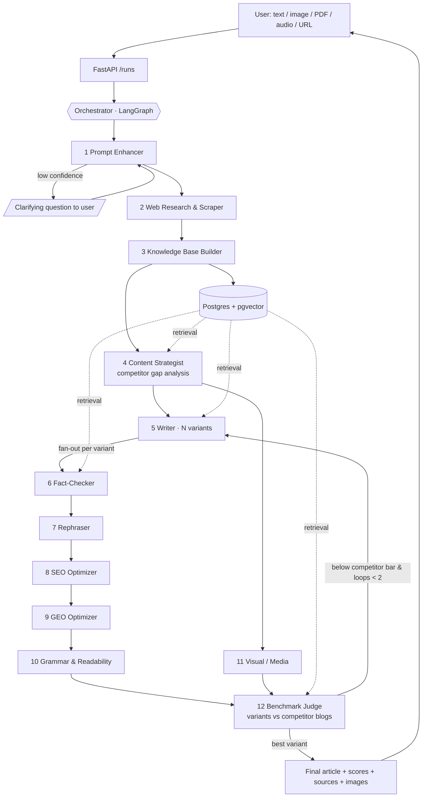

# Plan: Content Writing Multimodal Multi-Agent System

**Status:** Draft, awaiting approval
**Date:** 2026-10-22
**Complexity:** High (greenfield; about 13 agents, web UI, vector knowledge base)

---

## 1. Requirements Restatement

The user gives a topic as a prompt, plain text, or multimodal input (image, PDF, audio, URL). The system:

1. **Reviews and improves the prompt.** It works out intent, audience, tone, format and target keyword, and asks a clarifying question when the prompt is ambiguous.
2. **Researches the live web.** It searches and scrapes sources, including the blogs that currently rank for the topic.
3. **Builds a knowledge base** from what it scraped: chunked, embedded and cited.
4. **Writes** a draft grounded in that knowledge base.
5. **Rephrases** the draft for originality, flow and brand voice.
6. **Checks grammar** and readability.
7. **Optimizes for SEO**, the classic search-engine ranking.
8. **Optimizes for GEO** (Generative Engine Optimization), so that AI answer engines such as ChatGPT, Perplexity, Google AI Overviews and Claude are likely to cite the article.
9. **Compares** its drafts with the competitor blogs found on the internet, scores them all, and **returns only the best response** to the user.

Non-functional requirements: a modern, current tech stack; a user-friendly UI with live progress; traceable sources; cost limits; and no copying of competitor content.

> **Caveat:** No system can *guarantee* a top ranking. Rankings depend on domain authority, backlinks and time. The system maximizes the on-page factors it controls and measures them against the current top-ranking pages.

---

## 2. How Many Agents? **13** (1 Orchestrator + 12 Specialists)

| # | Agent | Responsibility | Model tier |
|---|---|---|---|
| 0 | **Orchestrator (Supervisor)** | Runs the LangGraph state machine, routing, parallel fan-out, revision loops, budget guard and human-in-the-loop pauses | Deterministic graph + Haiku for routing decisions |
| 1 | **Prompt Enhancer** (with multimodal intake) | Normalizes text, image, PDF, audio and URL input into one brief. Extracts intent, audience, tone, primary and secondary keywords, and format (listicle, guide, comparison…). Rewrites the prompt. Asks a clarifying question when confidence is low | Sonnet (vision) |
| 2 | **Web Research and Scraper** | Builds search queries, calls search APIs, and scrapes and cleans pages (honouring robots.txt). Tags each page as a *source* (facts) or a *competitor* (a ranking blog for the keyword) | Haiku + tools |
| 3 | **Knowledge Base Builder** | Chunks, embeds, dedupes and stores pages in a vector store. Extracts atomic facts and statistics with source URLs | Haiku + embeddings |
| 4 | **Content Strategist** | Analyzes competitor articles for structure, subtopics, word count, questions answered and content gaps. Produces the content brief and an outline that covers *more* than the competitors | Opus |
| 5 | **Writer** | Writes **N draft variants** (default 3, each from a different angle) with RAG grounding and inline citations | Opus |
| 6 | **Fact-Checker** | Checks every claim and statistic in a draft against the knowledge base. Flags or removes unsupported claims (hallucination guard) | Sonnet |
| 7 | **Rephraser / Humanizer** | Improves flow, applies brand voice, varies sentence rhythm, and enforces originality. Runs a similarity check against the scraped corpus so no competitor text is reused | Sonnet |
| 8 | **SEO Optimizer** | Places keywords and checks density; writes the title tag and meta description; fixes the H1–H3 hierarchy; suggests a slug, internal and external links, and image alt text; generates schema.org JSON-LD (Article, FAQPage, HowTo); produces an SEO score | Sonnet + rule engine |
| 9 | **GEO Optimizer** | Applies GEO techniques: an answer-first summary, quotable definitions, statistics with sources, expert quotations, FAQ blocks, entity clarity, and a TL;DR. Produces a GEO score by simulating an AI answer engine and checking whether it cites the article | Sonnet |
| 10 | **Grammar and Readability** | Runs **last**, because the SEO and GEO edits can introduce errors. LanguageTool finds deterministic errors, an LLM pass fixes style, and textstat measures readability against the target audience | LanguageTool + Haiku |
| 11 | **Visual / Media Agent** | Produces the multimodal output: a hero image prompt and generated image, diagram suggestions, alt text and an OG image. Runs in parallel with the polish pipeline | Sonnet + image-gen API |
| 12 | **Benchmark Judge** | Scores each finished variant **and** the top competitor blogs on the same rubric. Runs pairwise LLM-as-judge comparisons with position swapping to reduce bias, picks the best variant, and sends the draft back to the Writer with gap feedback if it does not beat the competitors (at most 2 loops) | Opus |

Model IDs: `claude-opus-5-5`, `claude-sonnet-5-5`, `claude-haiku-5-5`. The LLM layer is provider-agnostic (LangChain chat-model interface), so Ollama or another provider can be swapped in for local or cheap runs.

---

## 3. Architecture



### Key design decisions

- **LangGraph state machine rather than a free-form agent chat.** The flow is predictable, each run can be checkpointed and resumed, human-in-the-loop uses `interrupt()`, parallel variants use the `Send` API, and every step is traceable.
- **Variants are fanned out, then judged.** "Provide only the best response" becomes N full drafts that go through the whole polish pipeline in parallel, followed by one selection. N is configurable; N=1 is a cheap mode.
- **The score is a hybrid, not LLM opinion alone.** The final score combines deterministic metrics with the LLM judge:
  - SEO rule score (0–100)
  - GEO score (citation rate in a simulated answer engine)
  - Readability (Flesch, grade level relative to the audience)
  - Topical coverage: the share of competitor subtopics and entities covered, plus unique subtopics added
  - Factual support: the share of claims backed by the knowledge base
  - Originality: maximum embedding and n-gram similarity to any scraped page, which must stay below a threshold
  - LLM-judge pairwise win rate against each top-ranking competitor
- **Grammar runs last** in the text-editing chain.
- **Budget guard:** each run has a token and cost cap. The Orchestrator degrades gracefully, for example by lowering N or skipping the image, instead of failing.
- **Cache:** search results and scraped pages are cached in Redis, keyed by a URL hash with a TTL, so repeat topics are cheap.

### Shared graph state (Pydantic)

```
RunState
  run_id, user_input (text + attachments), refined_brief
  search_queries[], sources[] (url, title, type=source|competitor, markdown, fetched_at)
  kb_collection_id, facts[] (claim, source_url)
  competitor_profiles[] (url, outline, word_count, subtopics, scores)
  outline, drafts[] (variant_id, text, stage, scores{seo, geo, readability, coverage, factual, originality, judge})
  best_variant_id, iteration, cost_used, events[]
```

---

## 4. Tech Stack

| Layer | Choice | Why |
|---|---|---|
| Language (backend) | **Python 3.13** + **uv** | Best ecosystem for AI, scraping and NLP; uv is the fastest, most modern package manager |
| Agent orchestration | **LangGraph 1.x** | Stateful graphs, checkpointing, parallel `Send`, `interrupt()` human-in-the-loop, streaming; the industry standard for production multi-agent systems |
| LLMs | **Claude Opus 5.5 / Sonnet 5.5 / Haiku 5.5** via `langchain-anthropic` | Strong long-form writing and judging, native vision and PDF input, prompt caching to cut cost; tiered by agent |
| API | **FastAPI** + **Pydantic v2** + **SSE** | Async, typed, auto-generated OpenAPI docs; SSE streams the agent timeline live to the UI |
| Web search | **Tavily** (primary), **Exa** (semantic, optional) | Search APIs built for agents; return clean content and support recency filters |
| SERP / keyword data | **DataForSEO** (SERP top-N, keyword volume, People-Also-Ask) | Finds which blogs actually rank, which the competitor comparison needs |
| Scraping | **Crawl4AI** (LLM-ready markdown, Playwright under the hood) + **Trafilatura** fallback | Open source, handles JavaScript-heavy pages, clean article extraction |
| Doc parsing (multimodal input) | **Docling** (PDF/DOCX/PPTX) + Claude vision (images) + **faster-whisper** (audio) | Turns every input type into text |
| Knowledge base | **PostgreSQL 17 + pgvector** (HNSW) + Postgres full-text → hybrid search | One database for app data and vectors, so there is less infrastructure to run |
| Embeddings / rerank | **Voyage AI** `voyage-3.5` + `rerank-2.5` (local fallback: BGE-M3) | High retrieval quality; Anthropic's recommended embedding partner |
| Grammar | **LanguageTool** (self-hosted Docker) + LLM style pass; **textstat** readability | Deterministic, free, multilingual |
| SEO rules | Custom rule engine + `extruct` for schema validation | Transparent, testable scoring |
| Image generation | **fal.ai** (FLUX) or OpenAI `gpt-image` (pluggable) | Hero and OG images |
| Queue / cache | **Redis 7** (or Valkey) + **ARQ** async workers | Long runs happen off the request thread; cache and rate limits |
| Frontend | **Next.js 16** (App Router) + **React 19** + **TypeScript** + **Tailwind CSS v4** + **shadcn/ui** | Current, fast, accessible components |
| Editor / viewer | **TipTap** rich-text editor + Markdown/HTML/DOCX export | The user can edit the final article in place |
| Auth | **Better Auth** | Open source, self-hosted, simple |
| Observability | **Langfuse** (self-hosted) | Traces every agent call, token cost, prompt versions and eval scores |
| Evals / tests | **pytest** + **DeepEval** / **promptfoo** golden topic set; **Vitest** + **Playwright** for the web app | Catch quality regressions when prompts change |
| Deploy | **Docker Compose** (api, worker, web, postgres, redis, languagetool, langfuse) | One command locally; ports cleanly to a VPS or cloud |

---

## 5. Project Structure

```
ContentWritingAgenticSystem/
├── apps/
│   ├── api/                       # Python backend
│   │   ├── pyproject.toml
│   │   ├── src/cwas/
│   │   │   ├── main.py            # FastAPI app
│   │   │   ├── api/routes/        # runs.py, stream.py, export.py
│   │   │   ├── graph/
│   │   │   │   ├── state.py       # RunState
│   │   │   │   ├── builder.py     # LangGraph wiring
│   │   │   │   └── nodes/         # one file per agent (12) + orchestrator.py
│   │   │   ├── prompts/           # versioned system prompts per agent
│   │   │   ├── tools/             # search, scrape, serp, embed, languagetool, image_gen, ingest
│   │   │   ├── kb/                # chunker, store, retriever (hybrid + rerank)
│   │   │   ├── scoring/           # seo, geo, readability, coverage, originality, judge
│   │   │   ├── db/                # SQLAlchemy models, Alembic migrations
│   │   │   └── worker.py          # ARQ worker entrypoint
│   │   └── tests/                 # unit / integration / graph tests
│   └── web/                       # Next.js 16 frontend
│       ├── app/                   # /, /runs/[id], /history
│       └── components/            # PromptBox, AgentTimeline, ScoreCard, CompareTable, ArticleEditor
├── evals/                         # golden topics + expected quality thresholds
├── infra/docker-compose.yml
├── .env.example
└── Plan.md
```

---

## 6. Implementation Steps

### Phase 0: Foundations (Low)
1. Create a separate git repository for this folder. It currently sits inside the Desktop-wide repository.
2. Scaffold the monorepo: `apps/api` (uv, Python 3.13) and `apps/web` (pnpm, Next.js 16).
3. Write `infra/docker-compose.yml` with Postgres + pgvector, Redis, LanguageTool and Langfuse.
4. Add `.env.example` with the Anthropic, Tavily, DataForSEO, Voyage and fal keys, and typed settings via `pydantic-settings`.
5. Set up CI: ruff, mypy, pytest, plus eslint, tsc and vitest.

**Validate:** `docker compose up` comes up healthy; `uv run pytest` and `pnpm test` pass.

### Phase 1: Backend vertical slice (Medium)
6. Define `RunState` and the database schema: runs, run_events, sources, chunks (vector), drafts, scores.
7. Build the tools: `search.py` (Tavily), `scrape.py` (Crawl4AI + Trafilatura fallback, robots.txt check, Redis cache), `embed.py` (Voyage).
8. Build agents **1 Prompt Enhancer → 2 Research → 3 KB Builder → 5 Writer (N=1) → 10 Grammar** as LangGraph nodes.
9. Add the API: `POST /runs` (multipart), `GET /runs/{id}`, `GET /runs/{id}/stream` (SSE events per node), served by an ARQ worker.
10. Add the Postgres checkpointer so runs survive restarts.

**Validate:** an end-to-end run on 3 test topics returns a cited article; there are unit tests for each tool, with HTTP mocked.

### Phase 2: Frontend MVP (Medium)
11. Prompt box with file drag-and-drop (image, PDF, audio) and options: tone, length, audience, N variants.
12. Live **Agent Timeline**: each of the 13 agents shows its status, duration and cost, streamed over SSE.
13. Article view (TipTap) with a source list, plus copy and export to Markdown, HTML and DOCX.
14. Clarifying-question modal for the human-in-the-loop interrupt.

**Validate:** Playwright end-to-end test of prompt → live timeline → article.

### Phase 3: Quality agents (Medium)
15. **Agent 4 Content Strategist:** competitor outline extraction, subtopic and entity gap analysis, and an outline that covers the gaps.
16. **Agent 6 Fact-Checker:** split the draft into claims, retrieve evidence for each, and mark it supported, unsupported or contradicted. Unsupported claims are fixed or removed.
17. **Agent 7 Rephraser:** brand-voice rewrite plus the originality guard (embedding cosine and 8-gram overlap against every scraped page; above the threshold, rewrite the passage).
18. Use the Writer's prompt caching for the KB context.

**Validate:** factual-support ≥ 95% and originality similarity < threshold on the golden set.

### Phase 4: SEO and GEO (Medium)
19. **Agent 8 SEO:** DataForSEO keyword and SERP data; a rule engine covering title (50–60 chars), meta description (140–160), H-structure, keyword placement and density, slug, link suggestions and alt text; JSON-LD generation validated with `extruct`; a score from 0 to 100.
20. **Agent 9 GEO:** answer-first TL;DR, definition blocks, statistics with citations, quotations, an FAQ from People-Also-Ask, and clear entities. The GEO score asks an LLM "answer engine" the target questions with our article mixed in among the competitor pages, and measures how often it cites ours.
21. Add a score card UI that shows the SEO, GEO and readability breakdown with the issue list.

**Validate:** SEO rule unit tests; the GEO score is higher after optimization than before on the golden set.

### Phase 5: Competitor benchmark and best-response selection (High)
22. Fan out N variants with LangGraph `Send` (default 3 angles). Each variant goes through 6 → 7 → 8 → 9 → 10 in parallel.
23. **Agent 12 Benchmark Judge:**
    - Score each variant and each top-5 competitor on the same hybrid rubric (section 3).
    - Run pairwise LLM judging with A/B position swapping; a judgment counts only when both orders agree.
    - Pick the variant with the highest weighted score.
    - **Revision loop:** if the best variant does not beat the median top-3 competitor on coverage and judge win rate, send the gap list back to the Writer. At most 2 loops, under the budget guard.
24. **Compare** UI tab: a side-by-side table of our best variant against competitor URLs, metric by metric, plus why this variant won.

**Validate:** graph test that the loop ends; the judge is consistent (the same input gives the same winner ≥ 90% of the time).

### Phase 6: Multimodal (Medium)
25. Intake: Docling (PDF/DOCX), Claude vision (images and screenshots, e.g. "write about this product photo"), faster-whisper (audio and voice notes), and a URL to read from.
26. **Agent 11 Visual / Media:** hero and OG image generation, diagram suggestions (Mermaid), and alt text, embedded in the export.

**Validate:** one golden test per input type.

### Phase 7: Hardening, evals and observability (Medium)
27. Langfuse tracing on every node; per-run cost shown in the UI.
28. Golden evaluation suite of 20 topics in `evals/`, run in CI on prompt changes, failing below the quality thresholds.
29. Rate limiting, input size limits, SSRF protection on URL input (block private IPs), prompt-injection defence (scraped content is wrapped and treated as data, never as instructions).
30. Retries with backoff per tool, graceful degradation (for example, if DataForSEO is down, the SEO score comes from rules only).
31. Auth (Better Auth), run history and per-user quotas.

### Phase 8: Deploy (Low)
32. Production Docker images, a Compose file for the VPS, HTTPS reverse proxy, backups for Postgres.

---

## 7. API Surface

| Method | Path | Purpose |
|---|---|---|
| POST | `/runs` | Start a run (prompt + files + options) → `run_id` |
| GET | `/runs/{id}/stream` | SSE events: `agent_started`, `agent_finished`, `question`, `score`, `done`, `error` |
| POST | `/runs/{id}/answer` | Answer the human-in-the-loop clarifying question |
| GET | `/runs/{id}` | Full result: best article, all variant scores, competitor comparison, sources |
| GET | `/runs/{id}/export?format=md\|html\|docx` | Download the article |
| GET | `/runs` | History |

---

## 8. Risks

| Risk | Severity | Mitigation |
|---|---|---|
| Scraping is blocked (Cloudflare, paywalls) or violates terms of service | HIGH | Search APIs first (Tavily returns content), robots.txt honoured, cache, skip-and-continue, never bypass anti-bot protection |
| Hallucinated facts or statistics | HIGH | RAG-only claims, Fact-Checker agent, citation requirement, factual-support threshold |
| Plagiarism of competitor content (the Rephraser becomes "spinning") | HIGH | Originality guard against the whole scraped corpus; the Writer is told to synthesize, not paraphrase |
| Cost blow-up (N variants × 6 polish agents × 2 loops) | MEDIUM | Budget cap per run, Haiku for cheap steps, prompt caching, N configurable, loop cap |
| Latency (a full run can take minutes) | MEDIUM | Background worker, live SSE timeline, parallel variants and visual agent |
| LLM-judge bias (prefers its own writing or longer text) | MEDIUM | Position swapping, length-normalized rubric, deterministic metrics weighted alongside the judge |
| Prompt injection from scraped pages | MEDIUM | Scraped text wrapped as untrusted data, never placed in system prompts, tool calls limited to an allow-list |
| "Top rank" expectations | MEDIUM | Report on-page scores against competitors honestly; ranking also depends on off-page factors |
| Third-party API dependency (Tavily, DataForSEO, Voyage) | LOW | Pluggable tool interfaces with local fallbacks (DuckDuckGo search, BGE-M3 embeddings) |

---

## 9. Estimated Effort

| Phase | Estimate |
|---|---|
| 0 Foundations | 0.5 day |
| 1 Backend vertical slice | 2–3 days |
| 2 Frontend MVP | 2 days |
| 3 Quality agents | 2 days |
| 4 SEO + GEO | 2 days |
| 5 Benchmark Judge + variants + loop | 2–3 days |
| 6 Multimodal | 1–2 days |
| 7 Hardening + evals | 2 days |
| 8 Deploy | 0.5 day |
| **Total** | **~14–17 working days** |

## 10. Acceptance Criteria

- [ ] Text, image, PDF, audio or URL input produces one final, cited article
- [ ] All 13 agents are visible in the live timeline with status and cost
- [ ] The final article shows SEO, GEO, readability, coverage, factual-support and originality scores
- [ ] A comparison table against the top-ranking competitor blogs, with the reason this variant was chosen
- [ ] Factual support ≥ 95%, originality below the similarity threshold, on the golden set
- [ ] Export to Markdown, HTML and DOCX
- [ ] `docker compose up` runs the whole system locally
